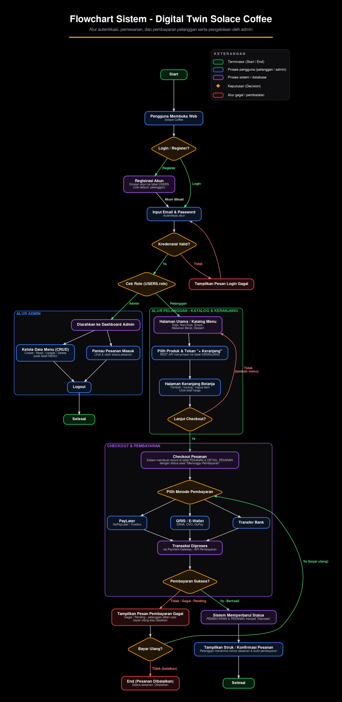
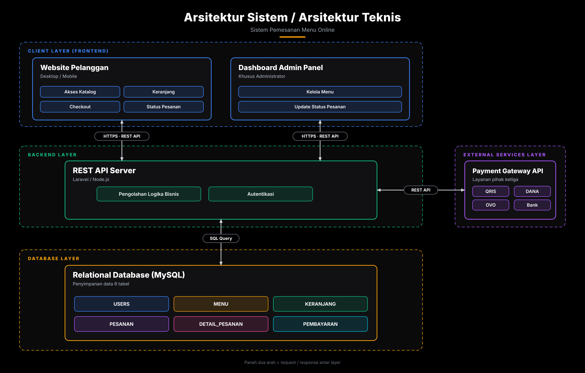
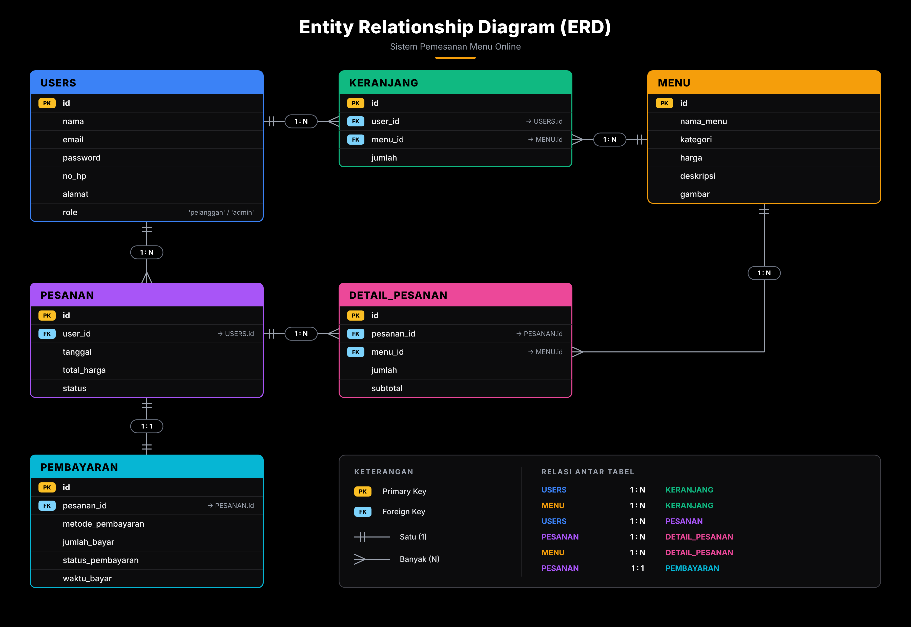
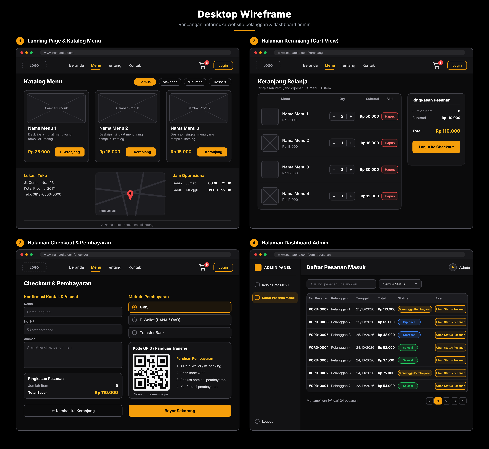

# 🛠️ Dokumentasi Perancangan Web - Solace Coffee

Dokumentasi ini merinci tahapan perancangan **Website Pemesanan Menu Online Solace Coffee (Digital Twin)** yang disusun mengikuti **alur pembuatan web**: dimulai dari memahami alur proses bisnis, merancang arsitektur teknis, merancang basis data, hingga merancang tampilan antarmuka.

| Tahap | Artefak | Pertanyaan yang Dijawab |
|:-----:|---------|--------------------------|
| 1 | Flowchart Sistem | *Apa saja alur proses yang harus didukung web?* |
| 2 | Arsitektur Sistem | *Teknologi dan lapisan apa yang membangun web?* |
| 3 | Entity Relationship Diagram (ERD) | *Data apa yang disimpan dan bagaimana relasinya?* |
| 4 | Desktop Wireframe | *Seperti apa tampilan halaman yang akan dibuat?* |

---

## 1. Flowchart Sistem (Alur Proses Bisnis)

Tahap pertama dalam pembuatan web adalah memahami **urutan proses** yang akan dijalankan sistem. **Flowchart** ini menggambarkan alur autentikasi, pemesanan, pembayaran oleh pelanggan, serta pengelolaan oleh admin, sehingga menjadi acuan bagi seluruh tahap perancangan berikutnya.

---

## 🧩 A. Simbol dan Kode Warna (Legenda)

*   **Terminator (hijau):** Titik awal (*Start*) dan akhir (*Selesai / End*) alur.
*   **Proses pengguna (biru):** Aktivitas yang dilakukan pelanggan atau admin.
*   **Proses sistem / database (ungu):** Aktivitas otomatis yang dijalankan sistem atau melibatkan basis data.
*   **Keputusan / *Decision* (belah ketupat kuning):** Titik percabangan berdasarkan kondisi tertentu.
*   **Alur gagal / pembatalan (merah):** Jalur penanganan ketika proses tidak berhasil.

---

## 🔐 B. Alur Autentikasi

*   **Pengguna Membuka Web:** Alur dimulai saat pengguna mengakses website Solace Coffee.
*   **Keputusan `Login / Register?`:**
    *   *Register:* Sistem menjalankan **Registrasi Akun**, yaitu menyimpan akun baru ke tabel `USERS` dengan *role* default `pelanggan`, lalu pengguna diarahkan ke input kredensial.
    *   *Login:* Pengguna langsung menuju input kredensial.
*   **Input Email & Password:** Tahap autentikasi akun.
*   **Keputusan `Kredensial Valid?`:**
    *   *Tidak:* Sistem menampilkan **Pesan Login Gagal** lalu mengembalikan pengguna ke input email dan password.
    *   *Ya:* Alur berlanjut ke pengecekan peran.
*   **Keputusan `Cek Role (USERS.role)`:** Sistem membaca kolom `role` pada tabel `USERS` untuk membagi alur menjadi **Admin** atau **Pelanggan**.

---

## 🛠️ C. Alur Admin

Jika hasil pengecekan role adalah **Admin**, maka:

*   **Diarahkan ke Dashboard Admin:** Admin masuk ke halaman pengelolaan khusus.
*   **Kelola Data Menu (CRUD):** Admin dapat *Create, Read, Update, Delete* pada tabel `MENU`.
*   **Pantau Pesanan Masuk:** Admin melihat dan mengubah status pesanan.
*   **Logout:** Setelah selesai, admin keluar dari sistem dan alur berakhir pada terminator **Selesai**.

---

## 🛒 D. Alur Pelanggan: Katalog dan Keranjang

Jika hasil pengecekan role adalah **Pelanggan**, maka:

*   **Halaman Utama / Katalog Menu:** Menampilkan kategori Kopi, Non-Kopi, Snack, Makanan Berat, dan Dessert.
*   **Pilih Produk & Tekan "+ Keranjang":** *REST API* menyimpan pilihan pelanggan ke tabel `KERANJANG`.
*   **Halaman Keranjang Belanja:** Pelanggan dapat menambah, mengurangi, atau menghapus item serta melihat total harga.
*   **Keputusan `Lanjut Checkout?`:**
    *   *Tidak (tambah menu):* Pelanggan kembali ke katalog untuk memilih menu lain.
    *   *Ya:* Alur berlanjut ke proses checkout.

---

## 💳 E. Alur Checkout dan Pembayaran

*   **Checkout Pesanan:** Sistem membuat *record* pada tabel `PESANAN` dan `DETAIL_PESANAN` dengan status awal **"Menunggu Pembayaran"**.
*   **Pilih Metode Pembayaran:** Pelanggan memilih salah satu dari tiga jalur:
    *   **PayLater** (GoPayLater / Kredivo)
    *   **QRIS / E-Wallet** (DANA, OVO, GoPay)
    *   **Transfer Bank**
*   **Transaksi Diproses:** Pembayaran diteruskan melalui *Payment Gateway* / API Pembayaran.
*   **Keputusan `Pembayaran Sukses?`:**
    *   *Ya / Berhasil:* Sistem memperbarui status `PEMBAYARAN` dan `PESANAN` menjadi **"Diproses"**, lalu menampilkan **Struk / Konfirmasi Pesanan** berisi nomor pesanan dan bukti pembayaran. Alur berakhir pada **Selesai**.
    *   *Tidak / Gagal / Pending:* Sistem menampilkan **Pesan Pembayaran Gagal** dan menawarkan pilihan lanjutan.
*   **Keputusan `Bayar Ulang?`:**
    *   *Ya (bayar ulang):* Pelanggan dikembalikan ke tahap **Pilih Metode Pembayaran**.
    *   *Tidak (batalkan):* Alur berakhir pada **End (Pesanan Dibatalkan)** dengan status pesanan *Dibatalkan*.

---

## 📌 F. Kesimpulan Tahap 1

Flowchart ini menegaskan bahwa web membutuhkan **tiga kelompok kemampuan utama**: (1) autentikasi berbasis *role*, (2) alur belanja pelanggan dari katalog hingga pembayaran, dan (3) pengelolaan menu serta pesanan oleh admin. Ketiganya menjadi dasar penentuan arsitektur, tabel basis data, dan halaman antarmuka pada tahap berikutnya.

---

## 2. Arsitektur Sistem (Arsitektur Teknis)

Setelah alur proses jelas, tahap kedua adalah menentukan **struktur teknis** web. **Arsitektur Sistem** membagi aplikasi ke dalam beberapa lapisan (*layer*) agar tanggung jawab tiap komponen terpisah dan mudah dikembangkan.

---

## 🏗️ A. Lapisan Arsitektur (Layers)

Sistem terdiri dari **empat lapisan** yang dibedakan berdasarkan warna garis putus-putus pada diagram:

### a. Client Layer (Frontend)
Lapisan antarmuka yang berinteraksi langsung dengan pengguna, terbagi menjadi dua aplikasi:
*   **Website Pelanggan** *(Desktop / Mobile)*: berisi modul **Akses Katalog**, **Keranjang**, **Checkout**, dan **Status Pesanan**.
*   **Dashboard Admin Panel** *(khusus administrator)*: berisi modul **Kelola Menu** dan **Update Status Pesanan**.

### b. Backend Layer
*   **REST API Server** *(Laravel / Node.js)*: pusat pengolahan permintaan dari frontend.
    *   **Pengolahan Logika Bisnis:** Menjalankan aturan transaksi seperti perhitungan total dan perubahan status pesanan.
    *   **Autentikasi:** Memverifikasi identitas dan hak akses pengguna.

### c. Database Layer
*   **Relational Database (MySQL)**: menyimpan data dalam **6 tabel**, yaitu `USERS`, `MENU`, `KERANJANG`, `PESANAN`, `DETAIL_PESANAN`, dan `PEMBAYARAN`.

### d. External Services Layer
*   **Payment Gateway API** *(layanan pihak ketiga)*: menyediakan opsi pembayaran **QRIS**, **DANA**, **OVO**, dan **Bank**.

---

## 🔗 B. Jalur Komunikasi Antar Lapisan

| Dari | Ke | Protokol | Keterangan |
|------|----|----------|------------|
| Website Pelanggan | REST API Server | `HTTPS · REST API` | Permintaan data katalog, keranjang, checkout, dan status pesanan (dua arah). |
| Dashboard Admin | REST API Server | `HTTPS · REST API` | Permintaan pengelolaan menu dan pembaruan status pesanan (dua arah). |
| REST API Server | MySQL Database | `SQL Query` | Baca dan tulis data ke 6 tabel (dua arah). |
| REST API Server | Payment Gateway API | `REST API` | Mengirim permintaan pembayaran dan menerima status pembayaran (dua arah). |

> *Panah dua arah pada diagram berarti terjadi* ***request / response*** *antar lapisan.*

---

## 📌 C. Kesimpulan Tahap 2

Arsitektur ini menerapkan pola **client-server berlapis**. Frontend tidak pernah mengakses database secara langsung, semua permintaan wajib melewati **REST API Server**. Pendekatan ini menjaga keamanan data, memungkinkan satu backend melayani dua antarmuka (pelanggan dan admin), serta mengisolasi integrasi pembayaran pihak ketiga pada satu titik.

---

## 3. Entity Relationship Diagram (Perancangan Basis Data)

Tahap ketiga adalah merancang **basis data** yang akan ditempatkan pada *Database Layer*. **ERD** memetakan seluruh tabel, atribut, kunci, dan relasi antartabel yang dibutuhkan untuk mendukung alur pada flowchart.

---

## 🗂️ A. Daftar Tabel dan Atribut (Entities & Attributes)

*(PK = *Primary Key*, FK = *Foreign Key*)*

*   **USERS**: Menyimpan data seluruh pengguna sistem.
    *   *Atribut:* `id` (PK), `nama`, `email`, `password`, `no_hp`, `alamat`, `role` (`'pelanggan'` / `'admin'`).
*   **MENU**: Katalog produk yang dijual.
    *   *Atribut:* `id` (PK), `nama_menu`, `kategori`, `harga`, `deskripsi`, `gambar`.
*   **KERANJANG**: Penampung item belanja sementara.
    *   *Atribut:* `id` (PK), `user_id` (FK → `USERS.id`), `menu_id` (FK → `MENU.id`), `jumlah`.
*   **PESANAN**: Rekaman utama transaksi pembelian.
    *   *Atribut:* `id` (PK), `user_id` (FK → `USERS.id`), `tanggal`, `total_harga`, `status`.
*   **DETAIL_PESANAN**: Rincian item pada setiap pesanan.
    *   *Atribut:* `id` (PK), `pesanan_id` (FK → `PESANAN.id`), `menu_id` (FK → `MENU.id`), `jumlah`, `subtotal`.
*   **PEMBAYARAN**: Rekaman pembayaran untuk setiap pesanan.
    *   *Atribut:* `id` (PK), `pesanan_id` (FK → `PESANAN.id`), `metode_pembayaran`, `jumlah_bayar`, `status_pembayaran`, `waktu_bayar`.

---

## 🔀 B. Relasi Antar Tabel dan Kardinalitas

| No | Tabel Induk | Kardinalitas | Tabel Anak | Analisis |
|:--:|-------------|:------------:|------------|----------|
| 1 | `USERS` | **1 : N** | `KERANJANG` | Satu pengguna dapat memiliki banyak baris item keranjang. |
| 2 | `MENU` | **1 : N** | `KERANJANG` | Satu menu dapat berada di keranjang banyak pengguna. |
| 3 | `USERS` | **1 : N** | `PESANAN` | Satu pengguna dapat membuat banyak pesanan dari waktu ke waktu. |
| 4 | `PESANAN` | **1 : N** | `DETAIL_PESANAN` | Satu pesanan terdiri dari satu atau banyak rincian item. |
| 5 | `MENU` | **1 : N** | `DETAIL_PESANAN` | Satu menu dapat tercatat pada banyak rincian pesanan. |
| 6 | `PESANAN` | **1 : 1** | `PEMBAYARAN` | Satu pesanan dipasangkan dengan tepat satu rekaman pembayaran. |

---

## 🔍 C. Analisis Struktur Data

*   **Tabel `KERANJANG` sebagai tabel penghubung:** Karena memuat `user_id` dan `menu_id`, tabel ini menyelesaikan relasi *many-to-many* antara `USERS` dan `MENU`. Setiap baris mewakili satu menu beserta `jumlah` yang dipilih pengguna.
*   **Tabel `DETAIL_PESANAN` sebagai tabel penghubung:** Tabel ini menyelesaikan relasi *many-to-many* antara `PESANAN` dan `MENU`, sekaligus menyimpan `jumlah` dan `subtotal` pada saat transaksi terjadi.
*   **Satu tabel `USERS` untuk dua peran:** Kolom `role` membedakan `pelanggan` dan `admin`, sehingga tidak diperlukan tabel akun terpisah. Kolom ini juga yang dibaca pada keputusan `Cek Role` di flowchart.
*   **Kolom `status` pada `PESANAN`:** Menampung tahapan pesanan seperti *Menunggu Pembayaran*, *Diproses*, *Selesai*, dan *Dibatalkan* sesuai alur pada flowchart.
*   **Pemisahan `PEMBAYARAN` dari `PESANAN`:** Status pembayaran dicatat terpisah dari status pengerjaan pesanan sehingga riwayat transaksi keuangan tetap rapi.

---

## 📌 D. Kesimpulan Tahap 3

ERD ini menghasilkan **6 tabel** yang sama dengan yang tercantum pada *Database Layer* di arsitektur sistem. Struktur tersebut telah mencakup seluruh data yang dibutuhkan alur flowchart: akun pengguna, katalog, keranjang, pesanan beserta rinciannya, dan pembayaran.

---

## 4. Desktop Wireframe (Rancangan Antarmuka)

Tahap terakhir adalah merancang **tampilan antarmuka** yang akan dibangun pada *Client Layer*. **Desktop Wireframe** menampilkan kerangka empat halaman utama website pelanggan dan dashboard admin sebagai panduan *frontend*.

---

## 🖥️ A. Halaman 1: Landing Page & Katalog Menu

*   **Navigasi (*header*):** Logo, tautan `Beranda`, `Menu`, `Tentang`, `Kontak`, ikon keranjang dengan *badge* jumlah item, dan tombol `Login`.
*   **Katalog Menu:** Berisi filter kategori (`Semua`, `Makanan`, `Minuman`, `Dessert`) dan kartu produk yang memuat gambar, nama, deskripsi singkat, harga, serta tombol `+ Keranjang`.
*   **Informasi Toko:** Bagian bawah halaman menampilkan **Lokasi Toko** (alamat, telepon, dan peta) serta **Jam Operasional** (Senin–Jumat dan Sabtu–Minggu).
*   **Footer:** Hak cipta toko.

> *Halaman ini mewujudkan use case* ***Lihat Menu*** *dan* ***Lihat Lokasi dan Jam Operasional****.*

---

## 🛍️ B. Halaman 2: Keranjang Belanja (*Cart View*)

*   **Daftar Item:** Tabel berisi menu, kolom **Qty** (tombol `–` dan `+`), **Subtotal**, dan tombol **Hapus** berwarna merah untuk tiap item.
*   **Ringkasan Pesanan:** Panel samping berisi jumlah item, subtotal, dan **Total** harga.
*   **Tombol `Lanjut ke Checkout`:** Mengarahkan pelanggan ke halaman checkout.

> *Halaman ini mewujudkan use case* ***Kelola Keranjang*** *dan keputusan* ***Lanjut Checkout?*** *pada flowchart.*

---

## 💳 C. Halaman 3: Checkout & Pembayaran

*   **Konfirmasi Kontak & Alamat:** Formulir `Nama`, `No. HP`, dan `Alamat` pengiriman.
*   **Metode Pembayaran:** Pilihan berbentuk *radio button*: **QRIS**, **E-Wallet (DANA / OVO)**, dan **Transfer Bank**.
*   **Kode QRIS / Panduan Transfer:** Menampilkan kode QR beserta empat langkah panduan: buka e-wallet / m-banking, scan kode QRIS, periksa nominal, lalu konfirmasi pembayaran.
*   **Ringkasan Pesanan:** Jumlah item dan **Total Bayar**.
*   **Tombol Aksi:** `← Kembali ke Keranjang` dan tombol utama `Bayar Sekarang`.

> *Halaman ini mewujudkan tahap* ***Pilih Metode Pembayaran*** *dan* ***Transaksi Diproses*** *pada flowchart.*

---

## 🧑‍💼 D. Halaman 4: Dashboard Admin

*   **Sidebar Admin Panel:** Menu `Kelola Data Menu`, `Daftar Pesanan Masuk`, dan `Logout`.
*   **Daftar Pesanan Masuk:** Tabel dengan kolom `No. Pesanan`, `Pelanggan`, `Tanggal`, `Total`, `Status`, dan `Aksi`.
*   **Pencarian & Filter:** Kolom cari berdasarkan nomor pesanan atau pelanggan, serta *dropdown* `Semua Status`.
*   **Label Status Berwarna:**
    *   🟡 **Menunggu Pembayaran**
    *   🔵 **Diproses**
    *   🟢 **Selesai**
*   **Tombol `Ubah Status Pesanan`:** Tersedia di setiap baris untuk memperbarui tahapan pesanan.
*   **Paginasi:** Navigasi halaman data pesanan (contoh: menampilkan 1–7 dari 24 pesanan).

> *Halaman ini mewujudkan use case* ***Lihat Daftar Pesanan*** *dan* ***Ubah Status Pesanan****, serta modul* ***Kelola Menu*** *dan* ***Update Status Pesanan*** *pada arsitektur.*

---

## 🔗 E. Keterkaitan Wireframe dengan Tahap Sebelumnya

| Halaman Wireframe | Proses pada Flowchart | Modul pada Arsitektur | Tabel pada ERD |
|-------------------|-----------------------|-----------------------|----------------|
| Landing Page & Katalog | Halaman Utama / Katalog Menu | Akses Katalog | `MENU` |
| Keranjang Belanja | Halaman Keranjang Belanja | Keranjang | `KERANJANG` |
| Checkout & Pembayaran | Checkout Pesanan, Pilih Metode Pembayaran | Checkout | `PESANAN`, `DETAIL_PESANAN`, `PEMBAYARAN` |
| Dashboard Admin | Alur Admin (Kelola Menu, Pantau Pesanan) | Kelola Menu, Update Status Pesanan | `MENU`, `PESANAN` |

---

## 📝 F. Catatan Konsistensi Antar Dokumen

Beberapa perbedaan kecil terlihat antar gambar dan sebaiknya diseragamkan sebelum tahap implementasi:

*   **Metode pembayaran:** Flowchart memuat *PayLater* (GoPayLater / Kredivo), sedangkan wireframe dan arsitektur hanya menampilkan QRIS, E-Wallet (DANA / OVO), dan Transfer Bank.
*   **Kategori menu:** Flowchart menyebut Kopi, Non-Kopi, Snack, Makanan Berat, dan Dessert, sedangkan wireframe hanya menampilkan Semua, Makanan, Minuman, dan Dessert.
*   **Relasi Pelanggan–Keranjang:** ERD menggambarkan `USERS` ke `KERANJANG` sebagai **1 : N** (satu baris per menu), sementara Class Diagram pada dokumen sebelumnya menuliskan **1 : 1**.
*   **Penamaan atribut:** Tabel `USERS` pada ERD memakai atribut `nama`, `no_hp`, `alamat`, dan `role`, sedangkan Class Diagram `User` memakai `name` dan belum memuat `no_hp`, `alamat`, serta `role`.
*   **Nama toko pada wireframe:** Masih memakai *placeholder* ("Nama Toko", `www.namatoko.com`) dan perlu diganti dengan identitas **Solace Coffee**.

---

## 🔄 G. Ringkasan Alur Pembuatan Web

*   **Tahap 1, Flowchart:** Alur proses bisnis dipahami dan disepakati.
*   **Tahap 2, Arsitektur Sistem:** Lapisan teknis (frontend, backend, database, layanan eksternal) ditentukan.
*   **Tahap 3, ERD:** Struktur data dan relasi antartabel dirancang.
*   **Tahap 4, Wireframe:** Tampilan halaman dirancang sebagai panduan implementasi *frontend*.

Setelah keempat tahap ini selesai, proses dapat dilanjutkan ke implementasi *backend* (API dan basis data), pembuatan *frontend* sesuai wireframe, integrasi *Payment Gateway*, dan pengujian.

*Developed with ☕ by Kelompok 1 - Rekayasa Perangkat Lunak*
