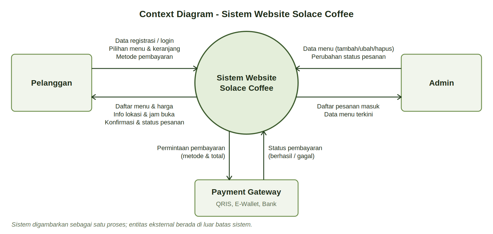
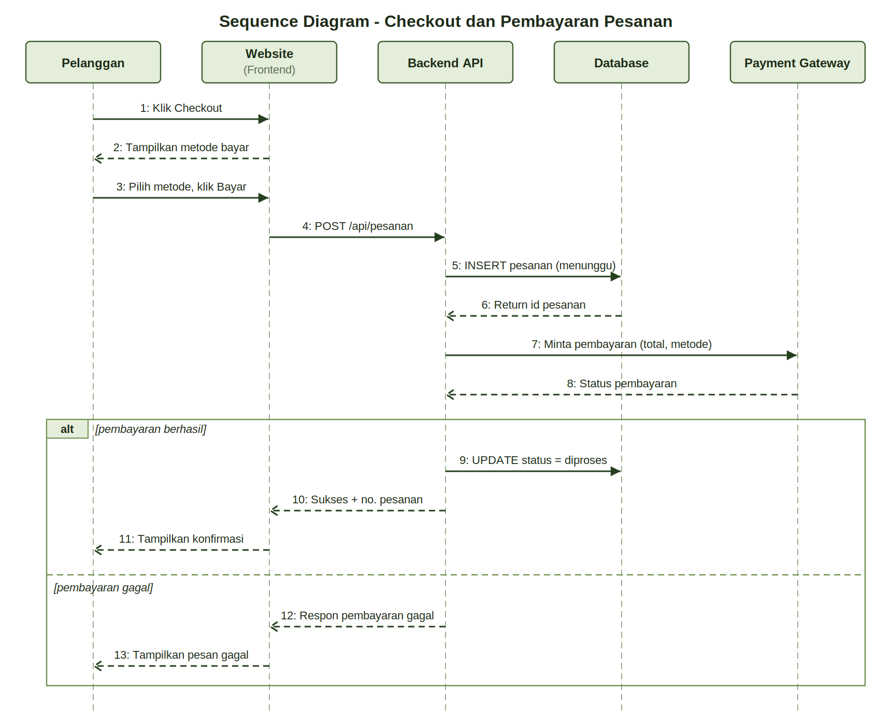
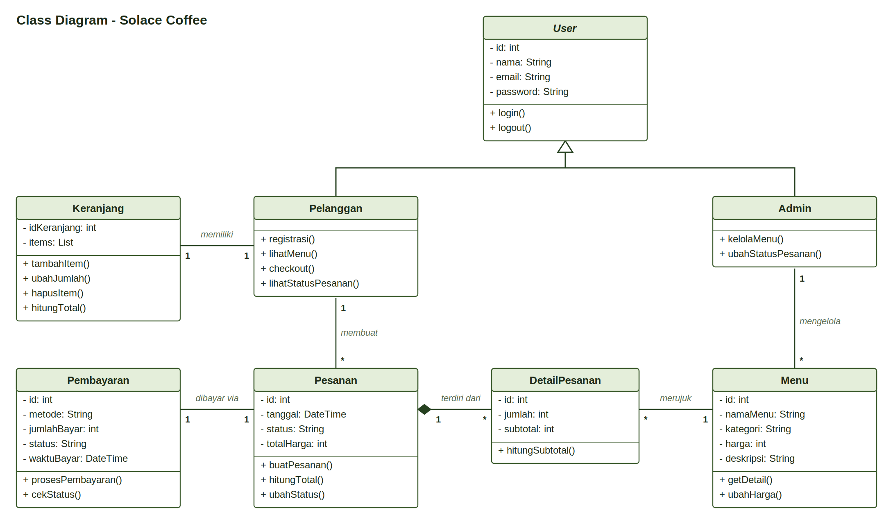

# 📊 Dokumentasi Perancangan Sistem - Solace Coffee

Dokumentasi ini merinci pemodelan sistem fungsional dan struktural dari platform **Digital Twin Solace Coffee** yang dibangun berdasarkan pendekatan *Object-Oriented Analysis and Design (OOAD)*.

---

## 1. Use Case Diagram (Interaksi Pengguna dengan Sistem)

### 💡 Penjelasan & Cara Kerja:
* **Pelanggan:** Memiliki hak akses penuh untuk melakukan registrasi/login, melihat daftar menu, mengelola keranjang belanja, melakukan *checkout* pesanan, memilih metode pembayaran (yang terhubung ke *Payment Gateway*), serta memantau lokasi dan jam operasional cafe.
* **Admin:** Berperan dalam pengelolaan sistem tingkat lanjut yang meliputi pengelolaan data menu (tambah, ubah, hapus), melihat daftar pesanan masuk dari pelanggan, serta mengubah status pesanan (misal: dari "Menunggu" menjadi "Diproses" atau "Selesai").
* **Relasi Khusus (`<<include>>`):** Proses *Checkout Pesanan* dan *Login* wajib melibatkan aksi *Pilih Metode Pembayaran* dan *Autentikasi* agar transaksi dapat diteruskan ke sistem.

---

## 2. Context Diagram (Batasan & Aliran Data Sistem)

### 💡 Penjelasan & Cara Kerja:
Diagram ini memandang sistem *Website Solace Coffee* sebagai satu kesatuan proses tunggal yang berinteraksi dengan tiga entitas luar:

* **Pelanggan ➔ Sistem:** Mengirimkan data registrasi/login, pilihan menu, isi keranjang, dan pilihan pembayaran. Sistem kemudian membalas dengan menampilkan daftar menu, harga, informasi lokasi, serta status konfirmasi pesanan[cite: 3].
* **Admin ➔ Sistem:** Mengirimkan pembaruan data menu serta perubahan status pesanan, dan menerima rekapitulasi daftar pesanan masuk secara *real-time*[cite: 3].
* **Payment Gateway ➔ Sistem:** Menjadi perantara pihak ketiga yang menerima permintaan pembayaran (total dan metode) serta mengembalikan status transaksi (*berhasil* atau *gagal*) ke dalam sistem[cite: 3].

---

## 3. Sequence Diagram (Alur Proses Checkout & Pembayaran)

### 💡 Penjelasan & Cara Kerja (Alur Step-by-Step):
1. **Pelanggan** menekan tombol *Checkout* pada antarmuka *Website (Frontend)*.
2. Sistem merespons dengan menampilkan pilihan metode pembayaran[cite: 4].
3. Setelah pelanggan memilih metode dan menekan *Bayar*, Frontend mengirimkan permintaan (`POST /api/pesanan`) ke **Backend API**[cite: 4].
4. **Backend API** menyimpan data pesanan berstatus *menunggu* ke dalam **Database**[cite: 4].
5. Setelah Database mengembalikan ID pesanan, Backend meneruskan permintaan tagihan pembayaran ke **Payment Gateway**[cite: 4].
6. **Kondisi Berhasil (`alt`):** Jika pembayaran terkonfirmasi sukses oleh *Payment Gateway*, Backend memerintahkan Database untuk memperbarui status pesanan menjadi *diproses*, lalu menampilkan halaman konfirmasi sukses beserta nomor pesanan ke layar pelanggan[cite: 4].
7. **Kondisi Gagal:** Jika transaksi ditolak/gagal, sistem menampilkan pesan error pembayaran kepada pelanggan[cite: 4].

---

## 4. Class Diagram (Struktur Objek & Basis Data)

### 💡 Penjelasan & Cara Kerja:
* **Inheritance (Pewarisan):** Kelas induk `User` diturunkan menjadi dua aktor turunan yaitu `Pelanggan` dan `Admin`, yang masing-masing mewarisi atribut dasar seperti `id`, `nama`, `email`, dan `password`.
* **Relasi Pesanan & Menu:**
  * `Pelanggan` dapat membuat banyak objek `Pesanan` (relasi 1 ke `*`)[cite: 2].
  * Satu `Pesanan` terdiri dari beberapa `DetailPesanan` yang merujuk pada data `Menu` tertentu[cite: 2].
  * `Admin` bertugas *mengelola* data `Menu` yang tersedia di aplikasi[cite: 2].
  * Proses transaksi diikat oleh kelas `Pembayaran` yang mencatat metode, jumlah bayar, waktu, serta status transaksi[cite: 2].

---
*Developed with ☕ by Kelompok 1 - Rekayasa Perangkat Lunak*
